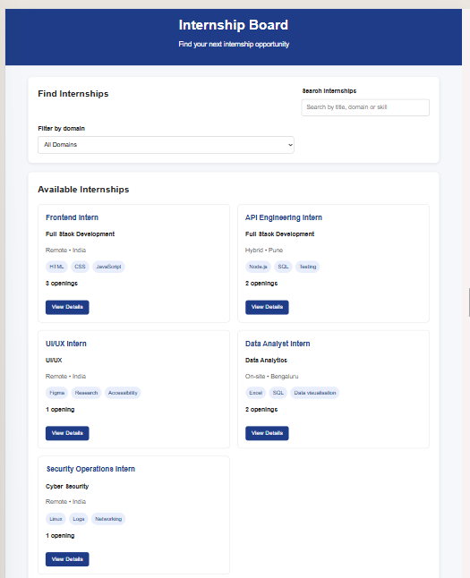
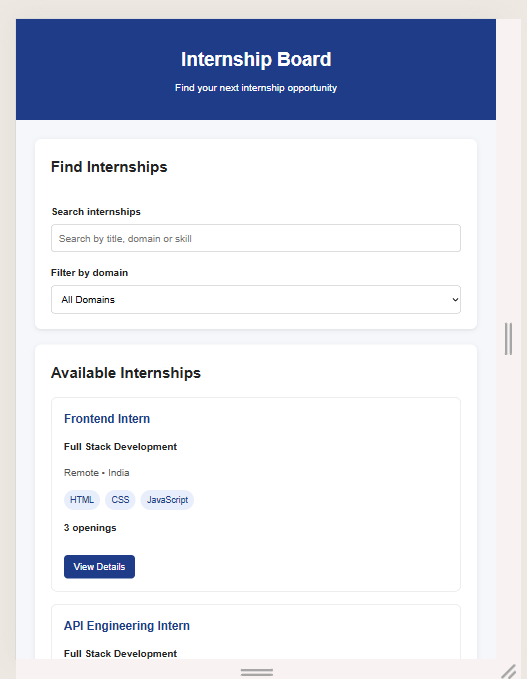

# Responsive Internship Board

A beginner-friendly, responsive internship listing website built using HTML, CSS, JavaScript, and JSON.

## 📌 Project Overview

The Responsive Internship Board allows users to browse internship opportunities and find relevant internships based on title, domain, location, work mode, and skills.

The website is designed to work across desktop, tablet, and mobile devices.

## ✨ Features

- View available internship opportunities.
- Search internships by title, domain, location, mode, and skills.
- Filter internships by domain.
- Display internship cards dynamically using JSON data.
- View internship details using the **View Details** button.
- Display an empty state when no internships match the search.
- Display an error state when internship data cannot be loaded.
- Provide keyboard-friendly form controls.
- Include accessible labels for search and filter controls.
- Support responsive layouts for desktop, tablet, and mobile devices.

## 🛠️ Technologies Used

- HTML5
- CSS3
- JavaScript
- JSON
- Visual Studio Code
- Live Server

## 🌐 Live Demo

[View the Responsive Internship Board](https://divyashree-bb.github.io/responsive-internship-board/)

## 📸 Screenshots

### Desktop View


### Tablet View


### Mobile View


## 📂 Project Structure

```text
responsive-internship-board/
├── .vscode/
│   └── settings.json
├── screenshots/
│   ├── desktop.png
│   ├── tablet.png
│   └── mobile.png
├── index.html
├── internships.json
├── README.md
├── script.js
└── style.css
```

## 🚀 How to Run Locally

1. Clone or download this repository.
2. Open the project folder in Visual Studio Code.
3. Open `index.html` using the Live Server extension.
4. Use the search box and domain filters to explore internships.

## 👩‍💻 Project Purpose

This project was developed to practise responsive web design, DOM manipulation, JSON data handling, search and filtering functionality, and basic accessibility.

---

**Project:** Responsive Internship Board  
**Task:** Edvyro Full Stack Development — Task 02


Task 03 — REST API and Persistent Data

## Task 03 — REST API and Persistent Data

### Overview
This task adds a REST API to the Internship Board using Node.js, Express, and SQLite. Internship records are stored persistently in a database.

### Technologies
- Node.js
- Express.js
- SQLite
- better-sqlite3

### Features
- Retrieve all internships with pagination.
- Retrieve an internship by ID.
- Create a new internship.
- Update an existing internship.
- Delete an internship.
- Validate required fields, work modes, URLs, IDs, and pagination parameters.
- Return appropriate HTTP status codes.
- Store internship data in an SQLite database.

### Backend Setup

1. Open a terminal in the `backend` directory.
2. Install dependencies:

   ```bash
   npm install
   ```

3. Initialize the database and sample records:

   ```bash
   node db.js
   ```

4. Start the API server:

   ```bash
   node server.js
   ```

The server runs at `http://localhost:3000`.

### API Endpoints

| Method | Endpoint | Purpose |
|---|---|---|
| GET | `/` | Health check |
| GET | `/api/internships?page=1&limit=2` | List internships with pagination |
| GET | `/api/internships/:id` | Get one internship |
| POST | `/api/internships` | Create an internship |
| PUT | `/api/internships/:id` | Update an internship |
| DELETE | `/api/internships/:id` | Delete an internship |

### Testing
The following were tested successfully:
- GET endpoints and pagination.
- POST, PUT, and DELETE operations.
- Validation of missing fields and invalid work modes.
- Invalid IDs and pagination limits.
- Requests for nonexistent internships.

### Notes
The included sample internship records and application URLs are for demonstration and testing purposes.